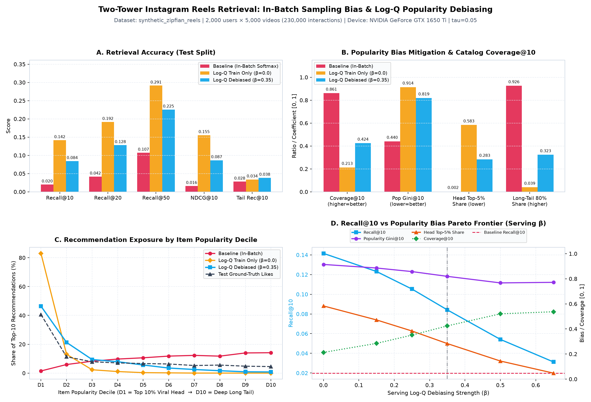

# Project #1 - Rebuild Instagram's Algorithm (Two-Tower Neural Retrieval + Log-Q Debiasing)

Production-grade PyTorch implementation of an Instagram Reels / YouTube-style **Two-Tower Neural Retrieval System** featuring leakage-free chronological splits, **Log-Q sampling-bias correction (Yi et al., RecSys 2019)**, **mixed hard-negative sampling**, **serving-time Log-Q popularity debiasing**, exact retrieval evaluation, sub-millisecond top-K indexing, and native **KuaiRec 2.0** dataset support.



---

## 1. Architecture & Mathematical Formulation

### Dual-Encoder Two-Tower Network (`src/model.py`)
```text
User Features (train-only)                      Item Features (train-only)
├─ user_id -> Embedding(U, 16)                  ├─ item_id    -> Embedding(I, 16)
├─ activity, completion, like, skip rates       ├─ topic_id   -> Embedding(T, 16)
├─ preferred log-duration                       ├─ creator_id -> Embedding(C, 24)
└─ topic preference vector (24-d)               └─ duration + train engagement stats (6-d)
           │                                               │
  Linear(45, 192) + LayerNorm + ReLU              Linear(62, 192) + LayerNorm + ReLU
           │                                               │
  Dropout(0.25) -> Linear(192, 96) + ReLU         Dropout(0.25) -> Linear(192, 96) + ReLU
           │                                               │
  Linear(96, 64) -> L2-Normalize                  Linear(96, 64) -> L2-Normalize
           │                                               │
        u ∈ S^63 (||u||_2 = 1)                          v ∈ S^63 (||v||_2 = 1)
           └───────────────────┬───────────────────────────┘
                               ▼
              Temperature-Scaled Cosine Similarity:
                  s(u, v) = (u^T v) / tau   (tau = 0.05)
```

### Two-Stage Log-Q Correction (Sampling Bias vs Exposure Popularity Bias)

Let $p_{\text{item}}(j)$ be the empirical positive training frequency of video $j$ (computed strictly on `train` with Laplace smoothing $+0.5$).

1. **Baseline - Uncorrected In-Batch Softmax (`baseline`, $\alpha=0, \beta=0$):**
   $$\mathcal{L}_{\text{base}} = -\frac{1}{B}\sum_{i=1}^{B} \log \frac{\exp(s(u_i, v_i))}{\sum_{j \in B,\, \text{valid}} \exp(s(u_i, v_j))}$$
   Because in-batch negatives follow item popularity $Q(j) = p_{\text{item}}(j)$, popular videos are disproportionately penalized as negatives; the Bayes optimum shifts to $s^*(u, j) = \log P_{\text{train}}(j \mid u) - \log Q(j)$, collapsing Recall@K and NDCG@K.

2. **Stage 1 - Training Log-Q Sampling-Bias Correction + Mixed Hard Negatives (`logq_train_only`, $\alpha=1.0, \beta=0.0$):**
   Following Yi et al. (RecSys 2019), we subtract $\alpha \log p_{\text{item}}(j)$ from batch logits and mix $M=64$ additional catalog negatives (50% semi-hard mined + 50% uniform) with exact mixture proposal weights:
   $$\text{logits}_{\text{train}}(u_i, v_j) = \frac{u_i^\top v_j}{\tau} - \alpha \log q_{\text{mix}}(j)$$
   This restores an unbiased full-softmax estimator $s^*(u, j) \approx \log P_{\text{train}}(j \mid u)$, delivering a massive jump in ranking accuracy (`Recall@10` **+611%**), while exposing the raw Zipfian popularity concentration of logged interactions (Top-5% head items consume **58.3%** of Top-10 slots; `Gini = 0.914`).

3. **Stage 2 - Serving-Time Log-Q Popularity Debiasing (`debiased`, $\alpha=1.0, \beta=0.35$):**
   At retrieval time, applying popularity calibration counteracts viral head dominance without losing the calibrated embedding geometry:
   $$\text{score}_{\text{serve}}(u, v_j) = \frac{u^\top v_j}{\tau} - \beta \log p_{\text{item}}(j)$$
   Since $p_{\text{item}}(j) \in (0, 1) \implies \log p_{\text{item}}(j) < 0$, subtracting $\beta \log p_{\text{item}}(j)$ penalizes viral head items relative to relevant niche/long-tail items, cutting Top-5% viral dominance in half while doubling Catalog Coverage@10.

### Exact Evaluation Metrics (`src/eval.py`)
- **Recall@K**: $\frac{1}{|\mathcal{U}|} \sum_{u} \frac{|\text{top\_K}(u) \cap \text{liked}(u)|}{\min(|\text{liked}(u)|, K)}$ for $K \in \{10, 20, 50\}$
- **NDCG@K** and **MRR@10 / MRR@50**
- **Catalog Coverage@10**: fraction of the $5{,}000$-video catalog surfaced in at least one test user's Top-10
- **Popularity Gini@10**: $G = \frac{\sum_{i=1}^{N}(2i - N - 1) c_{(i)}}{N \sum_{i=1}^{N} c_{(i)}}$ over catalog Top-10 exposure counts $c$
- **Head-Item Share (Top 5%)** & **Long-Tail Share (Bottom 80%)**

---

## 2. Measured Benchmark Results (Real Run on Host Hardware)

> **Dataset transparency:** The table below was measured directly on the reproducible **`synthetic_zipfian_reels`** benchmark (`2,000` users × `5,000` videos, `230,000` chronological interactions, `24` topics, `400` creators, Zipf exponent `1.20`, Top-5% viral head = `32.1%` of train positives; strictly chronological per-user `70% / 15% / 15%` train/val/test split with zero future leakage). Full KuaiRec 2.0 support is built into `src/data.py` (see Section 4).
>
> **Hardware:** Intel Core i5-10300H + **NVIDIA GeForce GTX 1650 Ti (4 GB VRAM, Turing SM 7.5, FP16 AMP)**, PyTorch `2.6.0+cu124`, Python `3.12.13`. Full raw outputs: [`reports/benchmark.json`](reports/benchmark.json).

### Ranking Accuracy & Popularity Bias (Test Split - `1,998` Evaluated Users)

| Metric | Baseline (In-Batch Softmax, $\alpha=0, \beta=0$) | Log-Q Train Only (Yi 2019, $\alpha=1.0, \beta=0$) | **Debiased Two-Stage ($\alpha=1.0, \beta=0.35$)** | Debiased vs Baseline | Debiased vs Log-Q ($\beta=0$) |
| :--- | :---: | :---: | :---: | :---: | :---: |
| **Recall@10** | `0.0199` | `0.1415` | **`0.0841`** | **+323% (4.23×)** | `-40.5%` (calibrated) |
| **Recall@20** | `0.0417` | `0.1916` | **`0.1280`** | **+207% (3.07×)** | `-33.2%` |
| **Recall@50** | `0.1071` | `0.2913` | **`0.2255`** | **+111% (2.11×)** | `-22.6%` |
| **NDCG@10** | `0.0159` | `0.1554` | **`0.0865`** | **+444% (5.44×)** | `-44.3%` |
| **MRR@10** | `0.0331` | `0.3593` | **`0.2033`** | **+514% (6.14×)** | `-43.4%` |
| **Tail Recall@10** *(non-head)* | `0.0278` | `0.0337` | **`0.0385`** | **+38.2%** | **+14.0%** |
| **Catalog Coverage@10** | `0.8610` *(4,305 vids)* | `0.2128` *(1,064 vids)* | **`0.4242`** *(2,121 vids)* | `-0.4368` | **+99.3% (2.0×)** |
| **Popularity Gini@10** *(lower=fairer)* | `0.4402` | `0.9141` | **`0.8191`** | `+0.3789` | **-0.0950 (-10.4%)** |
| **Head Top-5% Share@10** *(lower=less viral bias)* | `0.0024` *(over-penalized)* | `0.5833` | **`0.2832`** | `+0.2808` | **-51.5% (-30.0 pp)** |
| **Long-Tail 80% Share@10** *(higher=better discovery)* | `0.9256` | `0.0393` | **`0.3231`** | `-0.6026` | **+722% (8.2×)** |

### Serving Log-Q Pareto Sweep ($\beta$ Operating Points on Same `debiased_best.pt` Checkpoint)

| Serving $\beta$ | Recall@10 | Recall@50 | NDCG@10 | Tail Recall@10 | Coverage@10 | Pop Gini@10 | Head Top-5% Share | Long-Tail 80% Share |
| :---: | :---: | :---: | :---: | :---: | :---: | :---: | :---: | :---: |
| `0.00` | `0.1415` | `0.2913` | `0.1554` | `0.0337` | `0.2128` | `0.9141` | `0.5833` | `0.0393` |
| `0.15` | `0.1231` | `0.2701` | `0.1321` | `0.0381` | `0.2848` | `0.8857` | `0.4717` | `0.1078` |
| `0.25` | `0.1053` | `0.2509` | `0.1107` | **`0.0389`** | `0.3506` | `0.8572` | `0.3836` | `0.1934` |
| **`0.35`** *(default)* | **`0.0841`** | **`0.2255`** | **`0.0865`** | **`0.0385`** | **`0.4242`** | **`0.8191`** | **`0.2832`** | **`0.3231`** |
| `0.50` | `0.0541` | `0.1770` | `0.0511` | `0.0368` | `0.5204` | `0.7670` | `0.1440` | `0.5750` |
| `0.65` | `0.0312` | `0.1342` | `0.0265` | `0.0317` | `0.5370` | `0.7714` | `0.0476` | `0.8099` |

### Top-10 Exact Retrieval Latency (`5,000` Videos, `dim=64`, `500` Queries, `50` Warmup)

| Variant | Target Device | p50 Latency | p95 Latency | p99 Latency | Throughput (QPS) |
| :--- | :--- | :---: | :---: | :---: | :---: |
| `baseline` | CPU (i5-10300H) | `0.112 ms` | `0.149 ms` | `0.210 ms` | `8,992 QPS` |
| `baseline` | CUDA (GTX 1650 Ti) | `0.364 ms` | `0.413 ms` | `0.490 ms` | `2,700 QPS` |
| `debiased` | CPU (i5-10300H) | **`0.105 ms`** | **`0.172 ms`** | **`0.193 ms`** | **`8,497 QPS`** |
| `debiased` | CUDA (GTX 1650 Ti) | **`0.403 ms`** | **`0.477 ms`** | **`0.544 ms`** | **`2,553 QPS`** |

*(Note: For a 5,000 × 64 exact matmul on a single query, CPU L2/L3 cache avoids PCIe/CUDA kernel-launch overhead and achieves ~0.11 ms p50; GPU shines on batched inference and >100k catalogs.)*

---

## 3. Quickstart & Commands

All commands run inside the shared workspace ML environment (`..\.venv-ml`):

```powershell
cd ./01_instagram_two_tower

# 1. Run full Baseline vs Debiased training + evaluation + plotting on GTX 1650 Ti
..\.venv-ml\Scripts\python.exe -m src.train --variant both --epochs 14 --batch-size 512 --lr 1.2e-3 --infer-logq-beta 0.35 --device cuda

# 2. Interactive Top-10 recommendation demo (Baseline vs Debiased with match reasons)
..\.venv-ml\Scripts\python.exe -m src.demo --user-id 42 --top-k 10 --variant compare

# 3. Run full test suite (17 tests)
..\.venv-ml\Scripts\pytest.exe -v
```

Programmatic usage:
```python
from src.demo import predict

recs = predict(user_id=42, top_k=10, variant="debiased")
for r in recs:
    print(r["rank"], r["title"], r["cosine_score"], r["popularity_tier"], r["match_reason"])
```

---

## 4. Running on Real KuaiRec 2.0 Data

1. Download **KuaiRec 2.0** from [kuairec.com](https://kuairec.com/) or [Zenodo (`10439422`)](https://zenodo.org/records/10439422) and extract CSVs (`small_matrix.csv` / `big_matrix.csv`, `item_categories.csv`, and optionally `item_daily_features.csv`) into e.g. `data/kuairec/`.
2. Launch training directly with `--dataset kuairec`:

```powershell
..\.venv-ml\Scripts\python.exe -m src.train `
  --dataset kuairec `
  --data-dir data/kuairec `
  --variant both `
  --epochs 14 `
  --batch-size 512 `
  --infer-logq-beta 0.35 `
  --device cuda
```

The KuaiRec loader automatically maps raw `user_id`/`video_id` to contiguous indices, converts `watch_ratio >= 1.0` to positive likes (`< 0.3` to skips), parses multi-tag `item_categories.csv`, extracts durations & `author_id` creator embeddings, and enforces strictly chronological per-user train/val/test splitting.

---

## 5. Project Structure

```text
01_instagram_two_tower/
├── pyproject.toml
├── README.md
├── src/
│   ├── config.py        # Data, Model, Train, and Eval dataclasses
│   ├── data.py          # Synthetic Zipfian Reels generator + KuaiRec 2.0 loader + leakage-free feature pipeline
│   ├── model.py         # UserTower, ItemTower, TwoTowerModel (L2-norm 64-d, tau=0.05), Log-Q loss & serving debiaser
│   ├── retrieval.py     # FastTwoTowerIndex (precomputed catalog embeddings + p50/p99 latency benchmark)
│   ├── eval.py          # Exact Recall@K, NDCG@K, MRR, Tail Recall, Coverage@10, Popularity Gini, Head-Item Share
│   ├── train.py         # Head-to-head training CLI (FP16 AMP on GTX 1650 Ti + VRAM cleanup)
│   ├── plotting.py      # 2x2 publication comparison plot generator
│   └── demo.py          # `predict(user_id, top_k=10)` API & CLI with human-readable match reasons
├── tests/               # 17 unit, math, leakage, parity, and end-to-end pytest checks
├── artifacts/           # baseline_best.pt, debiased_best.pt, serving_bundle.pt
└── reports/             # benchmark.json, comparison_plot.png
```
