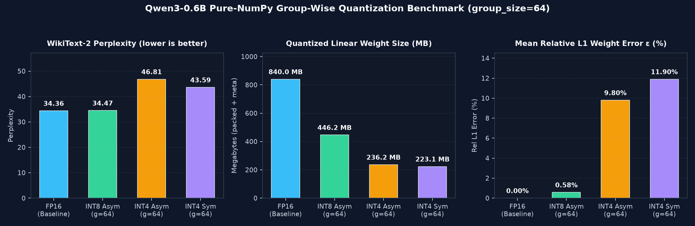
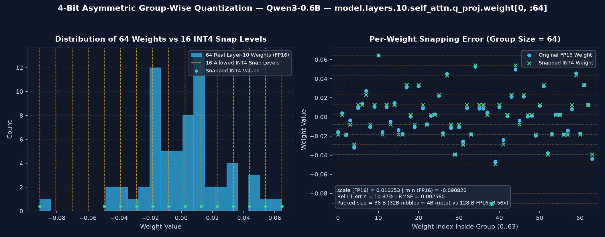

# Project #4 - Quantize Your Own LLM From Scratch (`Pure NumPy INT8/INT4 + Real 4-Bit Packing + GPTQ-lite` on `Qwen3-0.6B`)

A from-scratch, **pure-NumPy** group-wise LLM weight quantizer (`group_size=64`) featuring:
- Asymmetric & symmetric quantization with div-by-zero protection (`s = np.maximum(range / qmax, 1e-8)`),
- **Real 4-bit nibble packing** (`pack_int4` / `unpack_int4`: two INT4 values packed per `np.uint8` byte),
- Exact byte-size accounting including FP16 `scale` / `min` metadata overhead,
- Pure-NumPy **GPTQ-lite** (Hessian-aware blocked Cholesky error compensation) compared against RTN on real `Qwen3-0.6B` Layer-10 hidden activations,
- Real **WikiText-2 Perplexity** benchmark across all `196` transformer Linear projections (`440.40M` params; `embed_tokens` / tied `lm_head` kept in FP16),
- **Cross-Project Synergy:** evaluating the merged Project #2 **`Qwen3-0.6B + LoRA` Banking77** model after 4-bit quantization (`236.25 MiB` quantized linear weights).

> **Evidence-First Policy:** Every number below comes from real local execution on `Qwen/Qwen3-0.6B` (`reports/quant_benchmark.json`).

---

## Key Measured Results (`Qwen/Qwen3-0.6B`, GTX 1650 Ti 4 GB)

### 1. WikiText-2 Perplexity, Weight Error, and Packed Memory (`64 × 256 = 16,320` Tokens)

| Precision / Mode (`g=64`) | WikiText-2 PPL | ΔPPL | ΔPPL % | Global Rel L1 Err `ε` | Global RMSE | Quant Linear Size (MiB) | Bits/Weight (Linear) | Linear Compression | Full Model Size (MiB)* | Full Compression |
| :--- | :---: | :---: | :---: | :---: | :---: | :---: | :---: | :---: | :---: | :---: |
| **FP16 (Baseline)** | **34.3632** | 0.0000 | 0.00% | 0.000% | 0.000000 | 840.00 | 16.00 | 1.00× | 1,136.88 | 1.00× |
| **INT8 Asymmetric** | **34.4668** | +0.1036 | **+0.30%** | **0.577%** | 0.000153 | 446.25 | 8.50 | **1.88×** | 743.12 | 1.53× |
| **INT4 Asymmetric (packed)** | 46.8052 | +12.4420 | +36.21% | 9.779% | 0.002607 | **236.25** | **4.50** | **3.56×** | **533.12** | **2.13×** |
| **INT4 Symmetric (packed)** | **43.5865** | +9.2233 | **+26.84%** | 11.874% | 0.003156 | **223.12** | **4.25** | **3.77×** | **520.00** | **2.19×** |

*\*Note on exact deduplicated byte accounting (`tie_word_embeddings=True`): `Qwen3-0.6B` has `596,049,920` unique parameters = `440,401,920` quantized Linear parameters (`196` attention + MLP projections, `840.00 MiB` FP16) + `155,648,000` tied `embed_tokens`/`lm_head` & RMSNorm parameters (`296.88 MiB` kept in FP16). Packed INT4 stores `32 B` nibble data + `4 B` FP16 scale/min = `36 B` per 64 weights (`4.50` bits/w, `3.56×` linear compression) for asymmetric, and `34 B` per 64 weights (`4.25` bits/w, `3.77×` linear compression) for symmetric.*

**Key Real Observation:**
- **INT8 (`g=64`)** is virtually lossless (`+0.30%` PPL, `0.577%` relative L1 error) while cutting Linear weights nearly in half (`1.88×`).
- **INT4 Symmetric (`g=64`)** outperforms **INT4 Asymmetric (`g=64`)** on real WikiText-2 PPL (`43.59` vs `46.81`, `-3.22` PPL better) AND saves `13.12 MiB` of zero-point metadata (`3.77×` vs `3.56×`), because preserving an exact `0.0` grid point avoids systematic bias on zero-centered LLM weights despite higher raw L1 weight error.



---

### 2. Layer-10 Real Weight Snapping (`64` Real Weights vs `16` Allowed INT4 Levels)



- **Tensor Slice:** `Qwen/Qwen3-0.6B` `model.layers.10.self_attn.q_proj.weight[0, :64]`
- **Quantization Params (FP16 metadata):** `scale = 0.010353`, `w_min = -0.090820`
- **Measured Group Error:** Relative L1 Error `ε = 10.87%`, RMSE = `0.002560`, Max Abs Error = `0.004890`
- **Real Packed Footprint:** **`36 bytes`** (`32 B` packed nibbles + `4 B` FP16 scale/min) vs **`128 bytes`** FP16 (**`3.56×`** compression). Note how the single negative outlier (`-0.0908`) stretches the 16 uniform snap bins, visually explaining why Hessian-aware compensation (GPTQ) dramatically reduces output error.

---

### 3. Pure-NumPy GPTQ-lite vs RTN on Real Layer-10 Activations

Captured `2,048` real WikiText-2 hidden-state token activations entering `model.layers.10.self_attn.q_proj` (`2048 × 1024`) and quantized to **INT4 (`g=64`)** with empirical Hessian $H = \frac{2}{N} X^T X + \lambda I$ and upper-triangular inverse Cholesky error compensation:

| Method (`model.layers.10.self_attn.q_proj`, INT4 `g=64`) | Weight Rel L1 Error `ε` | Output Activation Rel L2 Error ($\|WX^T - \hat{W}X^T\|_F / \|WX^T\|_F$) | Error Reduction | Pure-NumPy Runtime |
| :--- | :---: | :---: | :---: | :---: |
| RTN Asymmetric (group=64) | 9.70% | 7.660% | baseline | - |
| **GPTQ-lite (Cholesky Hessian, `block=64`)** | 13.08% | **2.474%** | **-67.70% error** | **1.25 s** |

---

### 4. Cross-Project Synergy: Project #2 LoRA Banking77 Merged & Quantized to INT4 (`n = 385` Stratified, 5 × All 77 Intents)

| Model (`Qwen3-0.6B + Banking77 LoRA` Merged) | Exact-Match Acc | Macro-F1 (77 cls) | Top-3 Acc | Invalid-Label Rate | Quant Linear Size (MiB) | Full Model Size (MiB) |
| :--- | :---: | :---: | :---: | :---: | :---: | :---: |
| **LoRA Merged (FP16)** | **84.94%** | **84.73%** | **90.39%** | 2.86% | 840.00 (`1.00×`) | 1,136.88 |
| **LoRA Merged -> INT4 Asymmetric (`g=64`, packed)** | **76.10%** (`-8.84 pp`) | **77.11%** (`-7.62 pp`) | **84.16%** | 7.53% | **236.25 (`3.56×`)** | **533.12 (`2.13×`)** |

Even under naive round-to-nearest (RTN) 4-bit compression (`3.56×` smaller transformer linear weights), the quantized 0.6B Banking77 classifier still achieves **76.10% Exact-Match / 84.16% Top-3** across all 77 intents (compared to `0.00%` Base Zero-Shot and `4.16%` Base 5-Shot in Project #2).

---

## Project Layout

```text
04_quantize_your_own_llm/
├── src/
│   ├── quantizer.py     # Pure NumPy asymmetric/symmetric group-wise quantizer, pack_int4/unpack_int4, GPTQ-lite
│   ├── bench_qwen.py    # Real Qwen3-0.6B WikiText-2 PPL, Layer-10 GPTQ-lite ablation, Cross-Project LoRA INT4 eval
│   └── visualize.py     # Layer-10 64-weight vs 16-level snap plot + 3-panel benchmark summary chart
├── tests/
│   └── test_quantizer.py  # 16 pytest unit tests (100% PASS)
└── reports/
    ├── layer10_int4_snap.png
    ├── quant_summary.png
    └── quant_benchmark.json
```

---

## Quickstart Commands

```powershell
$py = "..\.venv-ml\Scripts\python.exe"

# 1. Run unit tests (16/16 PASS)
& $py -m pytest -v tests/test_quantizer.py

# 2. Run full Qwen3-0.6B quantization + GPTQ-lite + Cross-Project LoRA INT4 benchmark
& $py src/bench_qwen.py --group-size 64 --seq-len 256 --stride 256 --num-windows 64 --cross-eval-samples 385

# 3. Regenerate Layer-10 INT4 snap visualization standalone
& $py src/visualize.py
```
