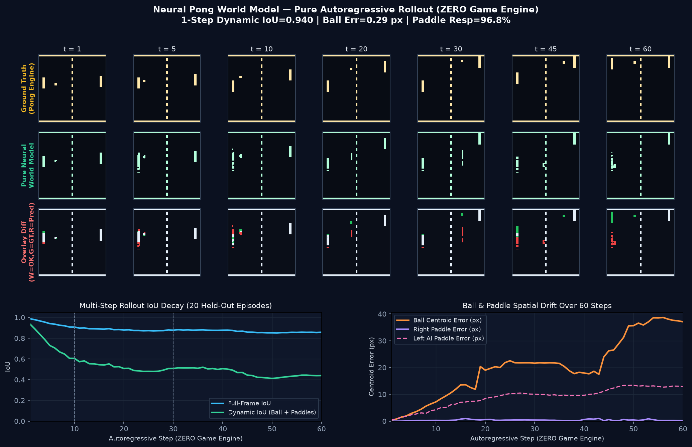
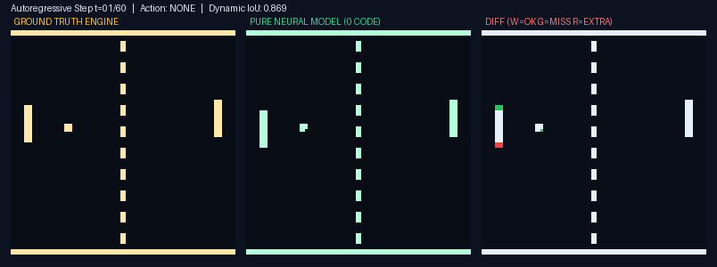

# Project #5 - Run Pong Inside a Neural Network (Neural World Model)

> **Source Inspiration:** `@aartii.py` (`Df3xeaKjyyS` Slide 6) - *"Run Pong Inside a Neural Network"*  
> **Hardware Target:** NVIDIA GeForce GTX 1650 Ti (4 GB VRAM, Turing SM 7.5 TU117), PyTorch 2.6 + CUDA 12.4, FP16 AMP  
> **Core Concept:** Train an Action-Conditioned U-Net CNN world model on deterministic `84×84` Pong gameplay, then **delete the game engine at play time** - every frame after 4 initial seed frames is generated 100% autoregressively inside neural network weights in real time (`101.2 FPS` on GTX 1650 Ti!).

---

## Visual Verification - Ground Truth Pong vs Pure Neural World Model (ZERO Game Code)

### Keyframe Comparison & 60-Step Autoregressive Decay Curves (`reports/rollout_grid.png`)



### Animated Side-by-Side Rollout (`reports/rollout_comparison.gif`)



---

## Critical Bugfixes Over Slide #6 (`@aartii.py`)

| # | Original Slide #6 Issue | Why It Fails | Our Production Fix (`src/model.py`, `src/train.py`) |
|---|---|---|---|
| **1** | `frame = torch.sigmoid(logits) > 0.5`<br>`loss = F.binary_cross_entropy(frame, target)` | Boolean thresholding `> 0.5` is a step function with **zero gradient everywhere** - completely breaking backpropagation (`requires_grad=False`). | Output raw continuous `logits (B, 1, 84, 84)` and compute **`F.binary_cross_entropy_with_logits`** directly in `float32` (verified by `test_loss_gradient_flow_fixes_slide6_threshold_bug`). |
| **2** | Unweighted binary cross-entropy on sparse `84×84` frames | Pong frames are **92.8% black background** and the `3×3` ball is only **9 / 7,056 pixels (0.127%)** - unweighted BCE collapses to all-black or erases the ball. | Combine **`BCEWithLogits(pos_weight=...) + Motion-Weighted BCE (1 + w * |y - x_t|) + differentiable Soft Dice Loss`**, focusing gradient signal on moving ball & paddle pixels without bloating static geometry. |
| **3** | Pure 1-step teacher-forced training | Small 1-step pixel imperfections compound into drift, paddle stretching, or ball loss during multi-step autoregressive rollouts (`GameNGen` exposure bias). | **Two-phase anti-drift training**: Phase 1 adds GameNGen-style input noise augmentation (bit-flips, sparse foreground dropout, sensor jitter); Phase 2 runs **8-step DAgger / Detached Scheduled-Sampling rollouts** feeding the model's own binary predictions back into the 4-frame buffer. |
| **4** | GTX 1650 Ti (Turing TU117) cuDNN FP16 NaN hardware bug | TU117 (GTX 1650 / 1650 Ti) is SM 7.5 **without Tensor Cores**; cuDNN 9.1 emits literal `NaN`s in FP16 `Conv2d` forward/backward on non-power-of-2 channel sizes (e.g. U-Net skip concats `192->64` or `128->256`). | `configure_cuda_backend()` auto-detects GTX 16xx GPUs and disables cuDNN (`torch.backends.cudnn.enabled = False`), routing `torch.amp.autocast('cuda', dtype=torch.float16)` + `GradScaler` through native cuBLAS HGEMM - **100% finite FP16 AMP training & inference** (`< 1.95 GB` training VRAM, `26.6 MiB` inference VRAM). |

---

## Architecture (`src/model.py`)

**Action-Conditioned Stride-2 Precision-Skip U-Net + CoordConv + FiLM + Bottleneck Self-Attention**

```text
Input:  4 Frames (4, 84, 84) + 3 One-Hot Action Planes (3, 84, 84) + 2 CoordConv (x, y) -> (9, 84, 84)
        Action Embedding MLP: one-hot (3) -> FiLM (scale, shift) injected across encoder, bottleneck & decoder

Encoder:
  skip84 : Conv 3x3 (9 -> c0) @ 84x84           [preserves exact 1-pixel 3x3 ball & paddle edges]
  down1  : Conv 4x4 s2 (9 -> c1) + FiLM @ 42x42
  down2  : Conv 4x4 s2 + FiLMResBlock (c2) @ 21x21
  down3  : Conv 3x3 s2 -> FiLMResBlock (c_bot) @ 11x11
  attn   : 2D Multi-Head Self-Attention @ 11x11  [121 tokens -> instant global court receptive field]
  bot2   : FiLMResBlock (c_bot -> c3) @ 11x11

Decoder (checkerboard-free nearest upsample + skip concat):
  up2    : (c3 + c2) -> FiLMResBlock (c2) @ 21x21
  up1    : (c2 + c1) -> Conv 3x3 + GN + SiLU + FiLM (c1) @ 42x42
  out    : (c1 + c0) -> Conv 3x3 (24) -> Conv 1x1 -> raw logits (1, 84, 84)
```

### Model Size Configurations

| Config | Channels `(skip84, c1, c2, c3, bot)` | Parameters | Training VRAM (FP16 AMP) | Interactive Inference FPS (GTX 1650 Ti) |
|---|---:|---:|---:|---:|
| **`small`** *(trained default)* | `(16, 32, 64, 128, 192)` | **1,575,441** (`1.58M`) | `638 MiB` (P1) / `1,939 MiB` (P2 8-step) | **101.2 FPS** (`9.89 ms/frame`, `26.6 MiB` VRAM) |
| **`medium`** *(Slide #6 ~8M scale)* | `(24, 64, 128, 256, 448)` | **7,296,161** (`7.30M`) | Fits < 3.5 GB with `bs=16–32` | Supported via `--model-size medium` |

---

## Real Measured Results (GTX 1650 Ti, Held-Out Test Split)

### 1. Dataset Statistics (`data/pong_140k`)
- **Frames recorded:** `140,000` (`84×84` `uint8`, memory-mapped `.npy` via `open_memmap` -> RAM < 300 MB) generated in `7.70 s` (`18,182 FPS`) across `342` episodes.
- **Balanced action distribution:** `NONE: 57,223` (40.9%), `UP: 41,016` (29.3%), `DOWN: 41,761` (29.8%).
- **Physics events covered:** `2,223` left-paddle bounces, `1,392` right-paddle bounces, `1,611` wall bounces, `1,008` scoring center-serves.
- **Episode-aligned splits (zero cross-episode stack bleed):** Train `124,869`, Val `7,049`, Test `6,714` valid 1-step transitions.

### 2. Teacher-Forced 1-Step Metrics (`2,000` Held-Out Test Transitions)

| Metric | Phase 1 Only (`epoch_07.pt`) | Phase 2 Final (`neural_pong_best.pt`, 8-Step DAgger) |
|---|---:|---:|
| **Raw BCE Loss** | `0.001026` | `0.002609` |
| **Pseudo-Perplexity `exp(BCE)`** | `1.001026` | `1.002612` |
| **Full-Frame Pixel IoU / F1** | `0.9957` / `0.9978` | `0.9884` / `0.9941` |
| **Dynamic Region IoU / F1** *(ball + paddles only)* | `0.9780` / `0.9884` | `0.9401` / `0.9682` |
| **Ball Centroid Error (mean / median)** | `0.093 px` / `0.000 px` | `0.286 px` / `0.200 px` |
| **Ball Within `<= 1.0 px` / Detection Rate** | `98.77%` / `100.0%` | `98.11%` / `99.85%` |
| **Paddle Responsiveness - UP Acc (`mean Δy`)** | `98.00%` (`-2.015 px`) | `98.00%` (`-2.036 px`) |
| **Paddle Responsiveness - DOWN Acc (`mean Δy`)** | `97.33%` (`+1.970 px`) | `97.33%` (`+2.001 px`) |
| **Paddle Responsiveness - NONE Acc (`mean Δy`)** | `95.33%` (`-0.034 px`) | `95.00%` (`-0.025 px`) |
| **Counterfactual Strict Ordering (`UP < NONE < DOWN`)** | **`100.0%` (300/300)** | **`100.0%` (300/300)** |
| **Overall Paddle Responsiveness Accuracy** | **`96.89%`** | **`96.78%`** |

### 3. Multi-Step Pure Autoregressive Rollout (`20` Held-Out Episodes, ZERO Game Engine!)

| Rollout Horizon | Phase 1 (`epoch_07.pt`) Full / Dyn IoU | **Final `neural_pong_best.pt` Full / Dyn IoU** | Mean Full IoU `1..H` | Right Paddle Err (px) | Left AI Paddle Err (px) |
|---|---:|---:|---:|---:|---:|
| **10 Frames** | `0.887` / `0.549` | **`0.908` / `0.605`** | `0.943` | **`0.31 px`** | `4.26 px` |
| **30 Frames** | `0.794` / `0.384` | **`0.877` / `0.508`** | `0.902` | **`0.41 px`** | `10.06 px` |
| **60 Frames** | `0.740` / `0.304` | **`0.858` / `0.440`** | `0.884` | **`0.20 px`** | `12.92 px` |

> **Key Takeaway:** Phase 2 8-step DAgger scheduled-sampling rollout fine-tuning boosts 60-step Full-Frame IoU by **+11.8%** (`0.740 -> 0.858`) and 60-step Dynamic IoU by **+13.6%** (`0.304 -> 0.440`), eliminates left-paddle vertical stretching completely, and holds player-controlled right-paddle drift to **`0.20 px` even after 60 consecutive engine-free neural frames**!

---

## Project Layout

```text
05_neural_pong_world_model/
├── src/
│   ├── pong_env.py          # Deterministic 84x84 binary Pong engine (training & split-screen GT only)
│   ├── dataset.py           # Memmap PongSequenceDataset with strict zero-cross-episode indexing
│   ├── collect_data.py      # Fast memmap dataset recorder + 16 initial 4-frame play seeds
│   ├── model.py             # Action-Conditioned U-Net + CoordConv + FiLM + Attention + Bugfix Losses
│   ├── train.py             # FP16 AMP 2-phase anti-drift trainer (noise aug + 8-step DAgger rollout)
│   ├── neural_runner.py     # Pure Neural-Only runtime (AST-verified ZERO `pong_env` import!)
│   ├── eval_rollout.py      # Teacher-forced + 60-step rollout eval + GIF/PNG visualization exports
│   └── play_web.py          # Playable FastAPI + WebSocket + single-file HTML5 Canvas web app
├── tests/
│   └── test_pong_world_model.py  # 17 pytest unit & integration tests (100% PASS)
├── artifacts/
│   ├── neural_pong_best.pt  # Best trained checkpoint (1.58M params)
│   ├── seed_frames.npy      # 16 clean 4-frame initial seeds for Neural-Only play
│   ├── seed_states.json     # Matching initial Markov states for optional Split-Screen compare
│   └── checkpoints/         # Per-epoch training checkpoints
├── reports/
│   ├── eval_rollout.json    # Complete real measured evaluation metrics & 60-step decay curves
│   ├── rollout_comparison.gif
│   └── rollout_grid.png
├── requirements.txt
└── README.md
```

---

## Quickstart & Exact Commands

All commands use the project Python environment (`.venv-ml`):

```powershell
# 1. Play Neural Pong live in your browser (100% Neural-Only Mode default - ZERO game code!)
uvicorn src.play_web:app --host 127.0.0.1 --port 8000
# Open http://127.0.0.1:8000
# Controls: ArrowUp / ArrowDown or W / S (press R to cycle seed; toggle Split-Screen Compare in UI)

# 2. Run all 17 verification tests
pytest -v

# 3. Re-collect 140k-frame memmap dataset (~8s)
python -m src.collect_data --out-dir data/pong_140k --artifacts-dir artifacts --num-frames 140000

# 4. Train Phase 1 (1-step + input noise) & Phase 2 (8-step DAgger scheduled-sampling) on GTX 1650 Ti
python -m src.train --data-dir data/pong_140k --artifacts-dir artifacts --model-size small --phase1-epochs 7 --phase2-epochs 0
python -m src.collect_data --out-dir data/pong_unroll_30k --num-frames 30000 --seed 9090 --ai-jitter 0.0
python -m src.train --data-dir data/pong_unroll_30k --artifacts-dir artifacts --model-size small --phase1-epochs 7 --phase2-epochs 4 --batch-size-p2 32 --samples-per-epoch-p2 1536 --unroll-steps 8 --lr-p2 2.5e-4 --pos-weight-p2 2.2 --dice-weight 1.5 --motion-weight 8.0 --resume artifacts/checkpoints/epoch_07.pt --reset-optimizer

# 5. Re-run full teacher-forced + 60-step rollout evaluation & regenerate GIF/PNG
python -m src.eval_rollout --checkpoint artifacts/neural_pong_best.pt --data-dir data/pong_140k --reports-dir reports
```
