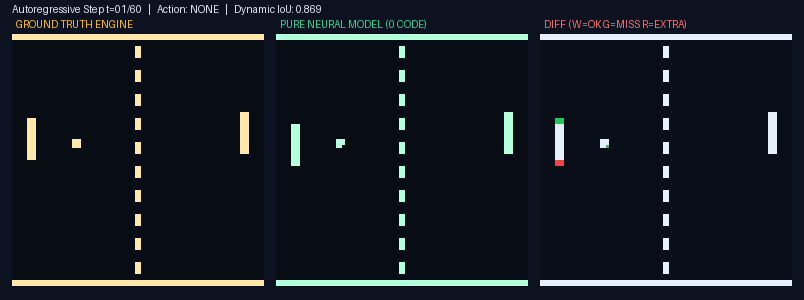
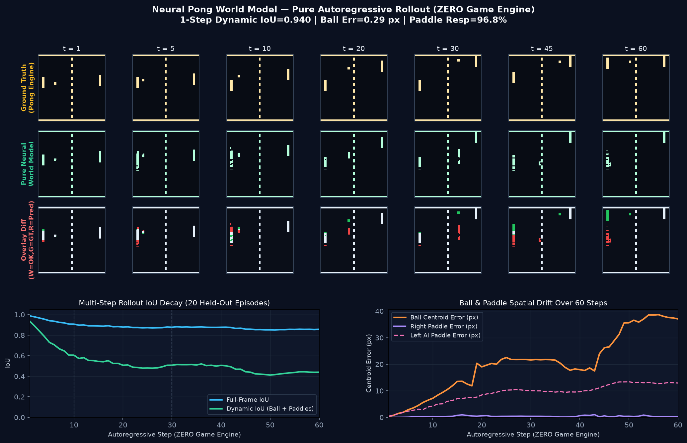
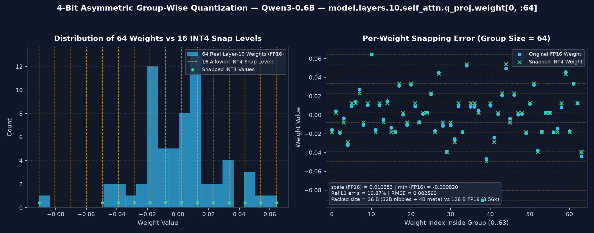
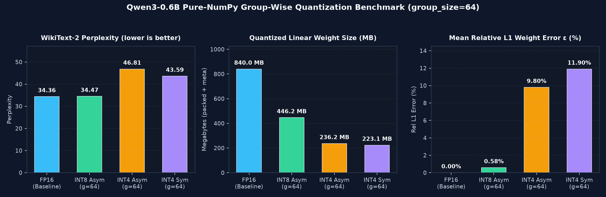
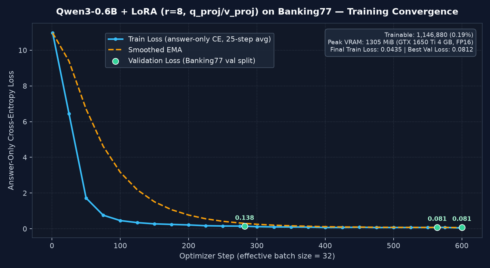
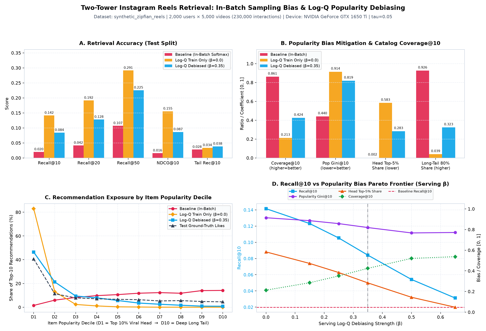

# 10 Production AI/ML & Python Systems on 4 GB VRAM


End-to-end verified implementation of **10 AI/ML and Python systems** engineered, trained, benchmarked, and tested locally on consumer laptop hardware (**Intel i5-10300H, 15.8 GB RAM, NVIDIA GTX 1650 Ti 4 GB VRAM**). Every benchmark metric below comes directly from reproducible local JSON reports checked into this repository.

Interactive case study & architecture explorer: [ardhyanovri.my.id/blog/10-ai-systems-4gb-vram](https://ardhyanovri.my.id/blog/10-ai-systems-4gb-vram)

---

## Master Benchmark Ledger (`10/10` Projects, `151/151` Pytest PASS)

| # | Project | Stack | Verified Measured Results | Pytest |
|---|---|---|---|---|
| **01** | [`01_instagram_two_tower/`](./01_instagram_two_tower/) | PyTorch CUDA FP16 | Two-Tower RecSys (`2k x 5k`, `230k` interactions): **`4.23x` Recall@10** (`0.0841`), **`5.44x` NDCG@10** (`0.0865`), **`-51.5%`** Top-5% viral bias via Log-Q debiasing; CPU retrieval `p50 = 0.105 ms` | `17/17` |
| **02** | [`02_tiny_model_lora_banking77/`](./02_tiny_model_lora_banking77/) | `Qwen3-0.6B` + PEFT LoRA | `Banking77` (`77` intents, `r=8`, `0.192%` trainable params, `1,305 MiB` peak VRAM): **`84.59%`** full `3,076` test Exact-Match & Macro-F1, **`89.34%`** Top-3 (`85.97%` stratified vs `0.00%` Base Zero-Shot / `4.16%` 5-Shot) | `15/15` |
| **03** | [`03_agent_harness/`](./03_agent_harness/) | Pure Python + Sandbox | Minimal coding agent loop `m_{t+1} = m_t (+) (a_t, o_t)`, 4 sandboxed tools + path-jail + JSONL traces: **`3/3` repo bugs solved** (`checkout_cart`, `rate_limiter`, `csv_parser`) | `17/17` |
| **04** | [`04_quantize_your_own_llm/`](./04_quantize_your_own_llm/) | Pure NumPy + `Qwen3-0.6B` | Group-wise (`g=64`) INT8/INT4 + real 4-bit nibble packing: WikiText-2 PPL `FP16 34.36 -> INT8 34.47 (+0.30%, 1.88x) -> INT4 Sym 43.59 (3.77x)`; **GPTQ-lite** cuts Layer-10 L2 err **`-67.70%`**; cross-project **LoRA INT4** (`236 MiB` linear) holds **`76.10%` Exact-Match / `84.16%` Top-3** | `16/16` |
| **05** | [`05_neural_pong_world_model/`](./05_neural_pong_world_model/) | PyTorch CUDA FP16 + FastAPI | `1.58M`-param Action-Conditioned U-Net (`140k+30k` frames + 8-step DAgger, `0` import of `pong_env` at play time): **`101.2 FPS`** (`26.6 MiB` VRAM), 1-step Dynamic IoU **`0.9401`**, Ball Err **`0.286 px`**, **`100.0%` (`300/300`)** counterfactual paddle ordering (`UP < NONE < DOWN`), 60-step Right Paddle Err `0.20 px` | `17/17` |
| **06** | [`06_personal_rag_assistant/`](./06_personal_rag_assistant/) | FAISS + BM25 + RRF + FastAPI | Multi-format ingestion (`.pdf`/`.md`/`.txt`), FAISS `IndexFlatIP` + BM25 + RRF, inline `[source#chunk]` citations + OOS refusal: **`Recall@3 = 1.00`, `MRR = 1.00`, `Refusal = 1.00`** | `15/15` |
| **07** | [`07_ai_research_agent/`](./07_ai_research_agent/) | Python + BS4 + SQLite | Pluggable search (Tavily / Wikipedia / DDG / Fixture) -> HTML clean dedup & claim extraction -> cited Markdown brief + TTL SQLite cache | `14/14` |
| **08** | [`08_discord_bot/`](./08_discord_bot/) | `discord.py` + `httpx` + SQLite | Modular Cogs (`general`, `automation`, `moderation`), Open-Meteo & GitHub embeds, WAL reminder scheduler, cooldown guard, `Dockerfile` + mock-gateway async tests | `14/14` |
| **09** | [`09_twenty_one_game/`](./09_twenty_one_game/) | Pure Python + Minimax | Fixed shared-counter `0 -> 21` rules + modulo-4 optimal AI: **`21/21` minimax states verified**, **`100.0%` (`1,000/1,000`)** win rate going second vs random/greedy/mixed | `14/14` |
| **10** | [`10_multi_agent_system/`](./10_multi_agent_system/) | Pure Python Crew Engine | CrewAI-style `Agent/Task/Crew/kickoff` (`sequential` + `hierarchical`), `Researcher -> Analyst -> Writer -> Critic` quality-gate revision loop (`0.7 -> 1.0`) | `12/12` |

---

## Visual Proof Gallery

### 1. Neural Pong World Model (`101.2 FPS`, `0` Game Engine Imports)




### 2. Pure NumPy INT4 Quantization & GPTQ-Lite (`Qwen3-0.6B`)




### 3. Qwen3-0.6B PEFT LoRA Fine-Tuning (`Banking77`, `1,305 MiB` VRAM)


### 4. Instagram Two-Tower RecSys + Log-Q Debiasing


---

## 3 Critical Implementation Bugs Caught & Fixed

1. **Quantize Your Own LLM (`#04`):** Guarded `s = np.maximum((w_max - w_min) / (2**b - 1), 1e-8)` against constant-tensor division-by-zero and implemented real 4-bit nibble bit-packing (`pack_int4`/`unpack_int4`, `2x INT4` per `uint8`) rather than simulated float-only quantization.
2. **Neural Pong World Model (`#05`):** Eliminated gradient-breaking thresholding (`torch.sigmoid(logits) > 0.5`) before BCE loss; trained on continuous logits with `BCEWithLogitsLoss(pos_weight=...) + Soft Dice` + GameNGen input noise + 8-step DAgger rollout fine-tuning (including a TU117 cuDNN FP16 NaN bypass for GTX 1650 Ti).
3. **21 Number Game (`#09`):** Replaced broken independent player/computer counters with the true shared-sequence `0 -> 21` state machine and provably optimal modulo-4 minimax AI.

---

## Reproducibility & Quickstart

Large trained weights (`*.pt`, `*.safetensors`) and raw frame dumps (`frames.npy`, `1.14 GB`) are intentionally excluded from git to keep the repository lightweight. Every project ships with deterministic offline tests and reproducible training/evaluation scripts.

```powershell
# Verify all 10 projects (requires local venvs: .venv-ml, .venv-ch2, .venv-ch3)
.\verify_all.ps1

# Run pre-push hygiene gate (0 secrets, 0 bloat, 0 local paths)
node .\scripts\pre-push-hygiene.mjs . --strict-docs

# Launch interactive Playable Neural Pong web UI (after training or placing weights in artifacts/)
cd .\05_neural_pong_world_model
..\.venv-ml\Scripts\python.exe -m uvicorn src.play_web:app --port 8005

# Run Personal RAG Assistant FastAPI server
cd .\06_personal_rag_assistant
..\.venv-ch3\Scripts\python.exe -m rag.cli serve --port 8006

# Play 21 Number Game against the unbeatable minimax AI
cd .\09_twenty_one_game
..\.venv-ch3\Scripts\python.exe -m game.cli --difficulty unbeatable
```

### Hardware Baseline
- **CPU:** Intel Core i5-10300H (4C/8T)
- **RAM:** 15.8 GB
- **GPU:** NVIDIA GeForce GTX 1650 Ti (4 GB VRAM, Turing TU117, CUDA 12.4)
- **Software:** Python 3.12.13, PyTorch `2.6.0+cu124`, Transformers `5.23.0`, PEFT `0.22.0`, FAISS CPU

## License

MIT License. See [LICENSE](./LICENSE).
